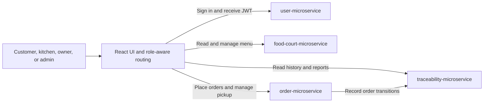

<!-- markdownlint-disable-next-line MD041 -->
<div align="center">

<h1>Food Court — Web App</h1>

<p><strong>Order lunch, run the kitchen queue, or manage the menu from the same web app.</strong></p>

<p>
<a href="https://github.com/diegnghtmr/food-court-ui/actions/workflows/ci.yml"></a>


<a href="LICENSE"></a>
</p>

<p>
<a href="https://diegnghtmr.me/en/work/food-court/"><strong>Case study</strong></a> &bull;
<a href="#quick-start"><strong>Quick start</strong></a> &bull;
<a href="#architecture"><strong>Architecture</strong></a> &bull;
<a href="https://github.com/diegnghtmr/order-microservice"><strong>Order API</strong></a>
</p>

</div>

<p align="center"></p>

A customer needs the menu and pickup status; kitchen staff need the queue; an owner needs to change dishes and give staff access. Food Court gives each role a distinct workspace while keeping all three views tied to the same restaurant and order. The Spanish-language interface uses stark borders and color-coded states to separate tasks at a glance.

## Features

- **Restaurant browsing.** Customers open a restaurant’s menu and browse available dishes by category.
- **Cart and checkout.** Customers adjust dish quantities, see totals in Colombian pesos, and place an order.
- **Order tracking.** Customers can revisit an order and see whether it is waiting, in preparation, ready, or delivered.
- **Kitchen queue.** Staff take orders, mark them ready, and verify a pickup code at handoff.
- **Owner workspace.** Owners manage dishes and employees and open reports on order fulfillment.
- **Admin workspace.** Administrators have screens for managing restaurant and owner records.

## Preview


*The kitchen board separates the next action for each order state.*


*The owner can open dish management, staff creation, or reports from the overview.*

The repository also keeps earlier captures of [sign-in](docs/00-login.png), [the customer workflow](docs/01-client.png), [the kitchen](docs/05-employee.png), [owner tools](docs/06-owner.png), and [the admin workspace](docs/08-admin.png).

## Quick start

Use Node.js 24 and npm, as in CI. Start the four [backend repositories](#related-repositories) for authenticated workflows; the browser calls them directly. The screenshots use a seeded restaurant because the catalog’s owner lookup did not match the Identity API’s route in the documented local run.

```sh
git clone https://github.com/diegnghtmr/food-court-ui.git
cd food-court-ui
HUSKY=0 npm ci
npm run dev
```

Open `http://localhost:3000`. The Vite server uses the local endpoints below by default. Set these overrides in the environment before launching Vite if any API runs on a different origin; do not put secrets in browser environment variables.

| Name | Purpose | Default |
| --- | --- | --- |
| `VITE_API_USUARIOS_URL` | Accounts and JWT sign-in | `http://localhost:8090/user-api` |
| `VITE_API_PLAZOLETA_URL` | Restaurants, dishes, and availability | `http://localhost:8091/foodcourt-api` |
| `VITE_API_PEDIDOS_URL` | Orders, kitchen queue, and pickup | `http://localhost:8092/order-api` |
| `VITE_API_TRAZABILIDAD_URL` | Order history and fulfillment reports | `http://localhost:8093/traceability-api` |

Use `npm run prepare` if you want the repository’s Git hooks. The case study also documents a category-field mismatch in the owner’s dish table.

## Architecture

The router selects guarded layouts by role. A feature owns code used only by that feature; code used by two or more moves to `shared/`, while API, auth, and theme wiring live in `infrastructure/`. Feature containers handle data and state while presentational components render props. TanStack Query owns server state; Zustand owns client state.



Supporting diagrams: [system context](docs/project-architecture.png), [relational entities](docs/sql-entities-diagram.png), [document entities](docs/nosql-entities-diagram.png), and [order lifecycle](docs/order-flow-diagram.png).

## Tech stack

| Layer | Technology |
| --- | --- |
| Interface | React 19, TypeScript 5, React Router, Tailwind CSS, Radix UI |
| Network and state | Axios, TanStack Query 5, Zustand 5 |
| Development and checks | Vite 6, Vitest, Playwright, ESLint, Prettier, Husky |

## Testing

```sh
npm test -- --run
```

[CI](.github/workflows/ci.yml) installs from the npm lockfile with hooks disabled and runs Vitest once. It does not run the production build or Playwright; the checked-in browser specs expect a running app on port `3000`. The current workflow also notes unresolved TypeScript errors in the production build.

| Task | Repository scripts |
| --- | --- |
| Watch, interactive runner, or coverage | `npm test`, `npm run test:ui`, `npm run test:coverage` |
| Lint or apply fixes | `npm run lint`, `npm run lint:fix` |
| Check or apply formatting | `npm run format:check`, `npm run format` |
| Build or serve an existing build | `npm run build`, `npm run preview` |

## Project structure

```text
src/
├── app/             # Root shell, router, and route guards
├── features/        # Auth, admin, owner, employee, and client workflows
├── shared/          # Code used by more than one feature
├── infrastructure/  # API, authentication, and theme
└── assets/          # Static UI assets
```

## Related repositories

| Repository | Role |
| --- | --- |
| [user-microservice](https://github.com/diegnghtmr/user-microservice) | Accounts, roles, and JWT sign-in |
| [food-court-microservice](https://github.com/diegnghtmr/food-court-microservice) | Restaurants, menus, and dish availability |
| [order-microservice](https://github.com/diegnghtmr/order-microservice) | Current orders, kitchen workflow, and pickup |
| [traceability-microservice](https://github.com/diegnghtmr/traceability-microservice) | Order transitions and fulfillment reports |

## License

Released under the [MIT License](LICENSE).
