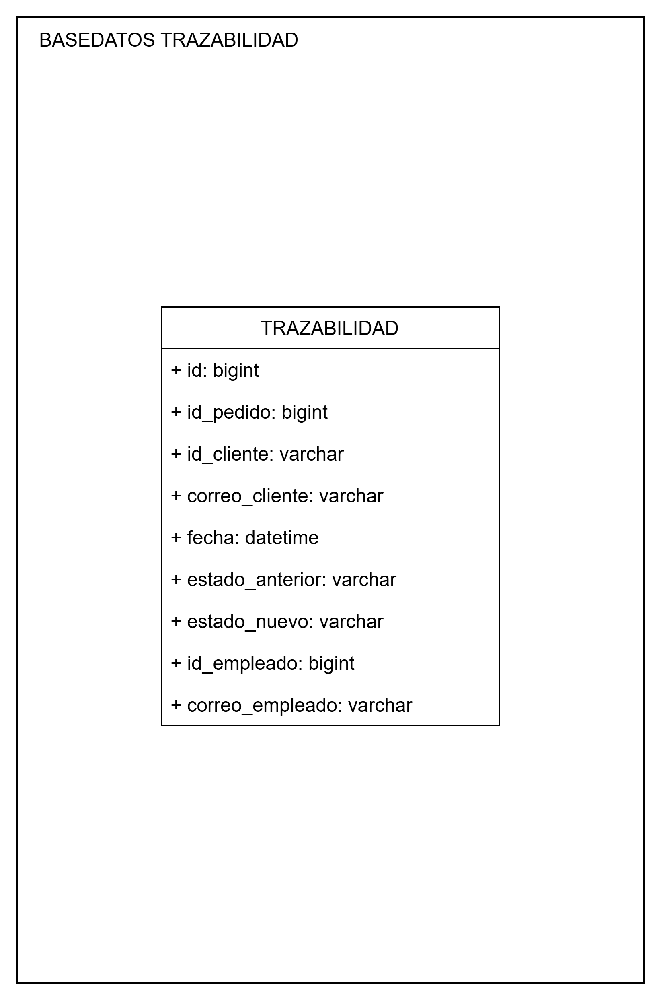
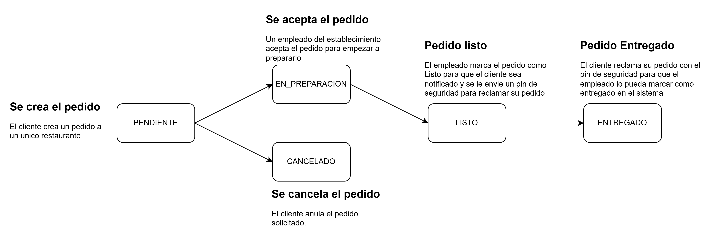
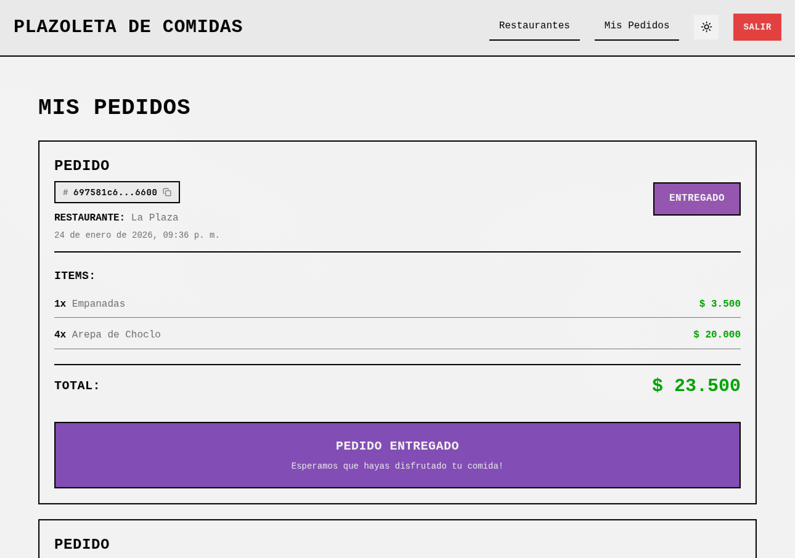
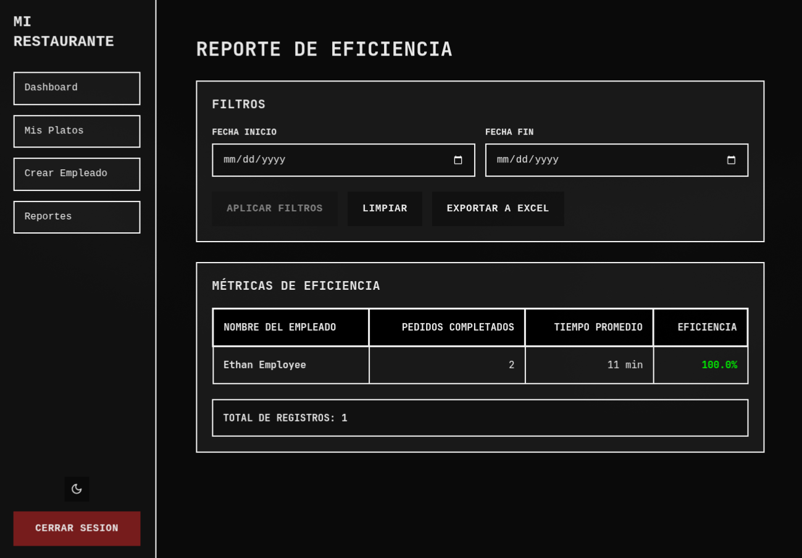

# Food Court UI


Role-based frontend for the Food Court platform. It serves admins, restaurant owners, employees, and clients while keeping the UI structure aligned with business features.

## Table of Contents
- [Overview](#overview)
- [System Context](#system-context)
- [Architecture](#architecture)
- [Feature Map](#feature-map)
- [Project Structure](#project-structure)
- [Placement Rules](#placement-rules)
- [Local Development](#local-development)
- [Scripts](#scripts)
- [Environment](#environment)
- [System Diagrams](#system-diagrams)
- [UI Screenshots](#ui-screenshots)
- [Related Repositories](#related-repositories)

## Overview
Food Court UI is the role-based client for the Food Court system. It orchestrates ordering and operational workflows by consuming dedicated backend services while enforcing the Scope Rule so the folder structure directly reflects business capabilities.

## System Context
- Consumes User, Food Court, Order, and Traceability APIs.
- Mirrors backend domain boundaries to keep front and back aligned.
- Uses route guards and role-aware layouts to enforce access.

## Architecture
The UI follows Scope Rule and Screaming Architecture.

- Scope Rule: code used by 1 feature stays local to that feature.
- Scope Rule: code used by 2 or more features moves to `shared/`.
- Screaming Architecture: features are named after business roles and use cases, not technical concerns.

Container and presentational pattern:
- Containers handle orchestration, state, and data fetching.
- Presentational components render UI and receive props.
- The main container file name matches the feature name (example: `features/client/client.tsx`).

## Feature Map
- Auth: login and access control.
- Admin: manage owners and restaurants.
- Owner: manage dishes, employees, and daily operations.
- Employee: manage order queue and state transitions.
- Client: browse restaurants, place orders, and track status.

## Project Structure
```
src/
  app/                    # Router, guards, root shell
  features/               # Business features (auth, admin, owner, employee, client)
  shared/                 # Reusable code used by 2+ features
  infrastructure/         # Cross-cutting concerns (API, auth, theme)
  assets/                 # Static assets
```

## Placement Rules
- If a file is used by one feature, keep it inside that feature.
- If a file is used by two or more features, move it to `shared/`.
- Cross-cutting code (API clients, auth, theme) lives in `infrastructure/`.

## Local Development
1. Install dependencies: `npm install`
2. Configure environment: `cp .env.example .env`
3. Set up Git hooks (optional): `npm run prepare`
4. Start dev server: `npm run dev`

## Scripts
- `npm run build` - production build
- `npm run preview` - preview build
- `npm run test` - run unit tests
- `npm run test:ui` - Vitest UI
- `npm run test:coverage` - coverage report
- `npm run lint` / `npm run lint:fix`
- `npm run format` / `npm run format:check`

## Environment
Environment variables are documented in `.env.example`. Do not commit secrets.

## System Diagrams

_High-level system context showing actors, UI, services, and databases._

_Relational model for users, restaurants, dishes, and orders in PostgreSQL._

_Document model for traceability events and order history in MongoDB._

_Order lifecycle from pending to delivered or canceled, including state transitions._

## UI Screenshots
### Authentication


### Client




### Employee


### Owner



### Admin


## Related Repositories
- [user-microservice](https://github.com/diegnghtmr/user-microservice)
- [food-court-microservice](https://github.com/diegnghtmr/food-court-microservice)
- [order-microservice](https://github.com/diegnghtmr/order-microservice)
- [traceability-microservice](https://github.com/diegnghtmr/traceability-microservice)
- [food-court-ui](https://github.com/diegnghtmr/food-court-ui)
