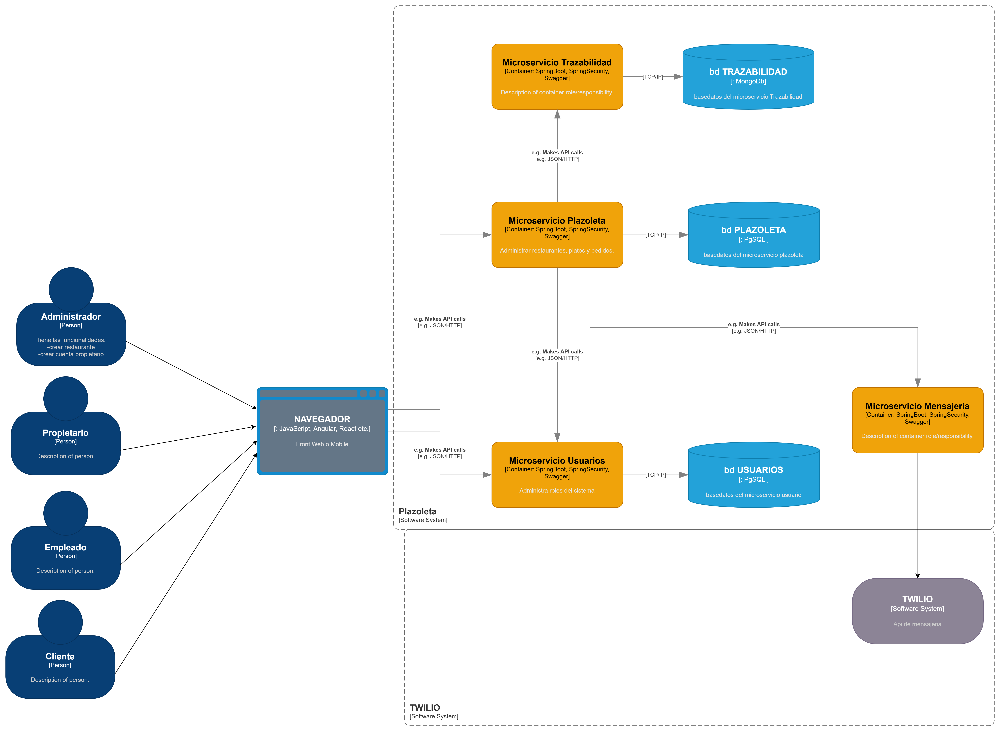
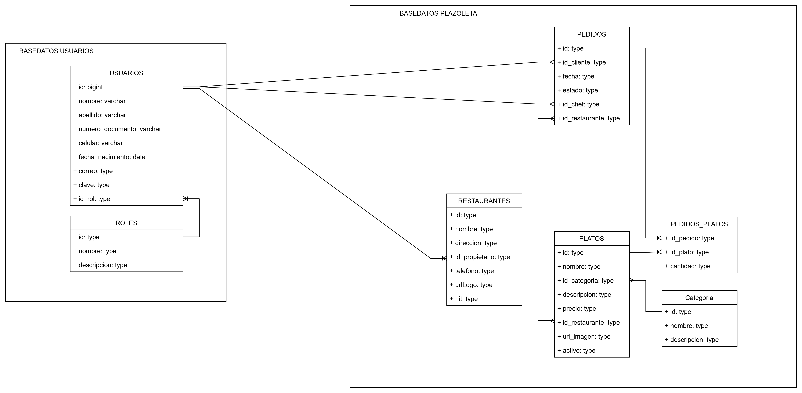
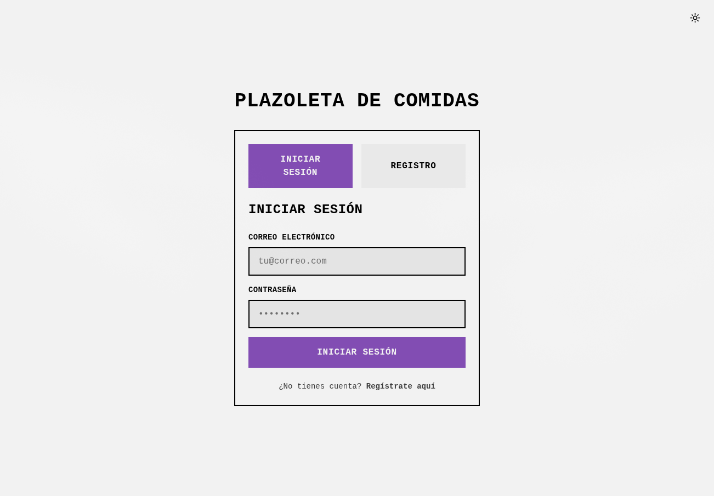
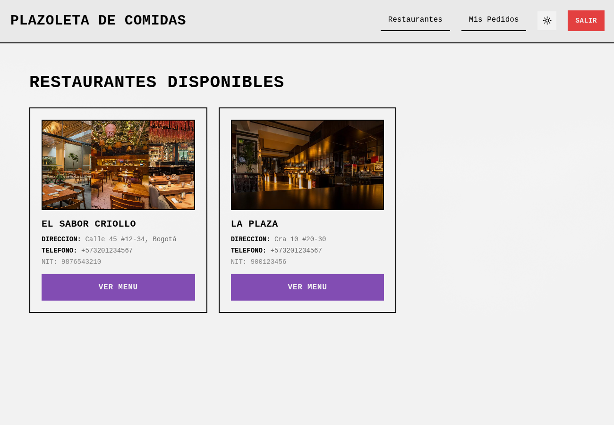
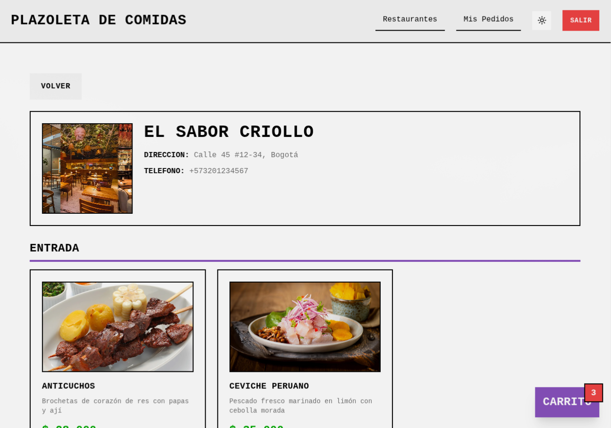
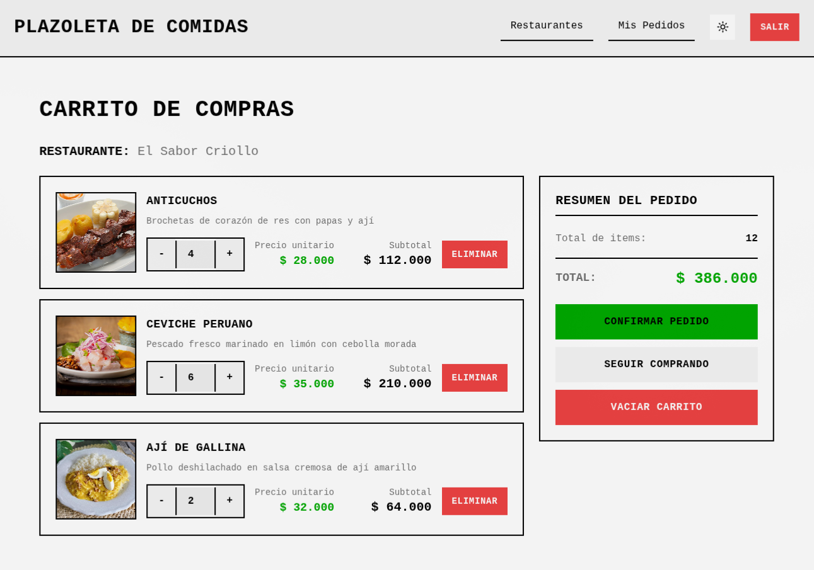
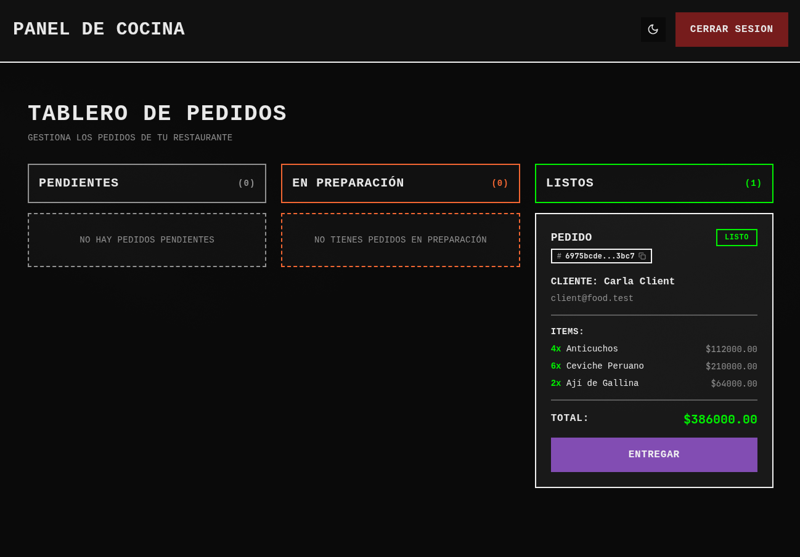
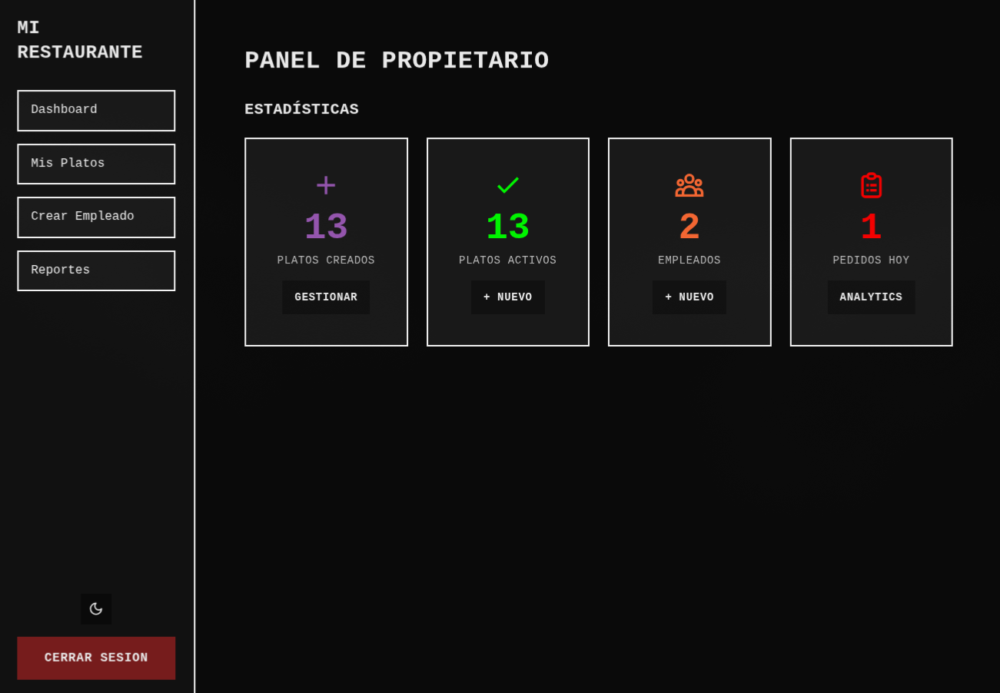
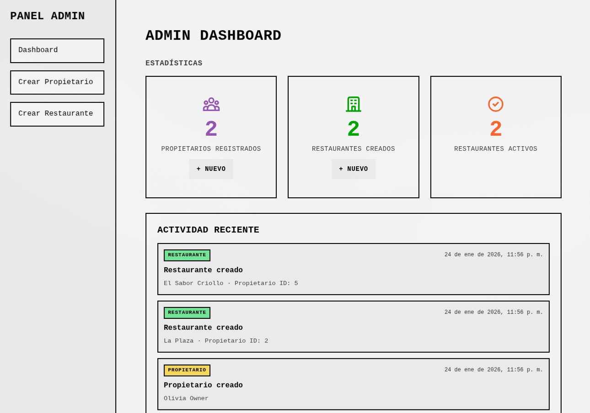

# Food Court UI

Frontend application for the Food Court system built with React 19, TypeScript, and Vite. It delivers role-based experiences for admins, restaurant owners, employees, and clients.

## System Context
- Consumes the User, Food Court, Order, and Traceability APIs.
- Mirrors backend domain boundaries using Scope Rule and Screaming Architecture.

## Tech Stack
- React 19, TypeScript 5, Vite 6
- React Router v6, Axios
- Zustand, React Hook Form + Zod
- Tailwind CSS, Radix UI
- Vitest, ESLint, Prettier

## Architecture (Scope Rule + Screaming Architecture)
The UI is organized around business features so the folder structure "screams" the domain.

### Folder Structure
```
src/
├── app/                    # App wiring (router, guards, root component)
├── features/               # Business features (auth, admin, owner, employee, client)
├── shared/                 # Reusable code used by 2+ features
├── infrastructure/         # Cross-cutting concerns (API, auth, theme)
└── assets/                 # Static assets
```

### Scope Rule
- Code used by 1 feature stays local to that feature.
- Code used by 2+ features moves to `shared/` or `infrastructure/`.

### Path Aliases
```
@app/*            -> src/app/*
@features/*       -> src/features/*
@shared/*         -> src/shared/*
@infrastructure/* -> src/infrastructure/*
@assets/*         -> src/assets/*
```

### Container / Presentational Pattern
- Containers handle orchestration, state, and data fetching.
- Presentational components render UI and receive props.

## Local Development
1. Install dependencies: `npm install`
2. Configure environment: `cp .env.example .env`
3. Set up Git hooks (optional): `npm run prepare`
4. Start dev server: `npm run dev`

## Scripts
- `npm run build` - production build
- `npm run preview` - preview build
- `npm run test` - run unit tests
- `npm run test:ui` - Vitest UI
- `npm run test:coverage` - coverage report
- `npm run lint` / `npm run lint:fix`
- `npm run format` / `npm run format:check`

## System Diagrams




## UI Screenshots
### Authentication


### Client





### Employee


### Owner



### Admin


## Related Repositories
- [user-microservice](https://github.com/diegnghtmr/user-microservice)
- [food-court-microservice](https://github.com/diegnghtmr/food-court-microservice)
- [order-microservice](https://github.com/diegnghtmr/order-microservice)
- [traceability-microservice](https://github.com/diegnghtmr/traceability-microservice)
- [food-court-ui](https://github.com/diegnghtmr/food-court-ui)
