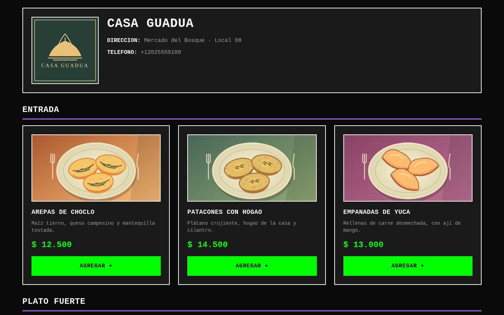
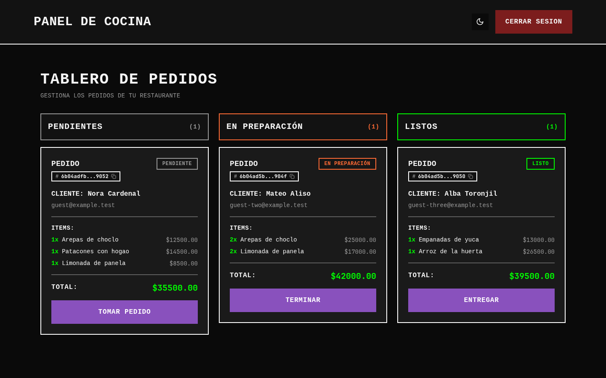
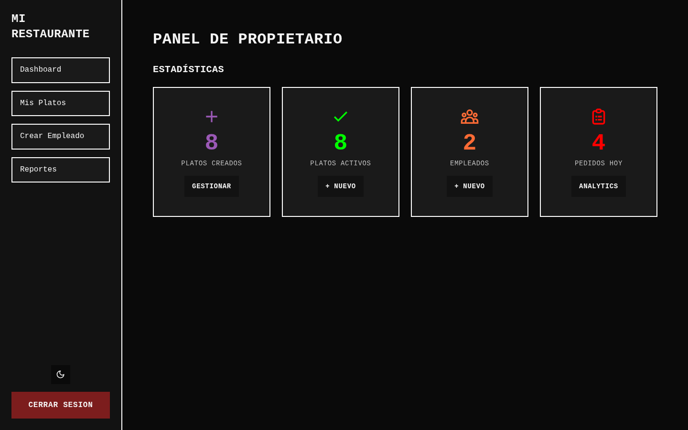
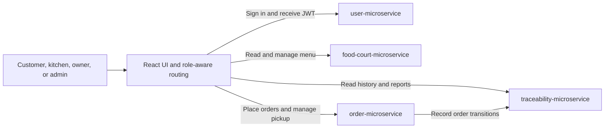

<!-- markdownlint-disable-next-line MD041 -->
<div align="center">

<h1>Food Court — Web App</h1>

<p><strong>Order lunch, run the kitchen queue, or manage the menu from the same web app.</strong></p>

<p>
<a href="https://github.com/diegnghtmr/food-court-ui/actions/workflows/ci.yml"></a>


<a href="LICENSE"></a>
</p>

<p>
<a href="https://diegnghtmr.me/en/work/food-court/"><strong>Case study</strong></a> &bull;
<a href="#quick-start"><strong>Quick start</strong></a> &bull;
<a href="#architecture"><strong>Architecture</strong></a> &bull;
<a href="https://github.com/diegnghtmr/order-microservice"><strong>Order API</strong></a>
</p>

</div>

<p align="center"></p>

A customer needs the menu and pickup status; kitchen staff need the queue; an owner needs to change dishes and give staff access. Food Court gives each role a distinct workspace while keeping all three views tied to the same restaurant and order. The Spanish-language interface uses stark borders and color-coded states to separate tasks at a glance.

## Features

- **Restaurant browsing.** Customers open a restaurant’s menu and browse available dishes by category.
- **Cart and checkout.** Customers adjust dish quantities, see totals in Colombian pesos, and place an order.
- **Order tracking.** Customers can revisit an order and see whether it is waiting, in preparation, ready, or delivered.
- **Kitchen queue.** Staff take orders, mark them ready, and verify a pickup code at handoff.
- **Owner workspace.** Owners manage dishes and employees and open reports on order fulfillment.
- **Admin workspace.** Administrators have screens for managing restaurant and owner records.

### Feature map

See the [routes and workflows by role](docs/reference.md#feature-map).

## Preview



*The kitchen board separates the next action for each order state.*



*The owner can open dish management, staff creation, or reports from the overview.*

### UI screenshots

Browse the [earlier captures of sign-in and all four roles](docs/reference.md#ui-screenshots).

## Quick start

Use Node.js 24 and npm, as in CI. Start the four [backend repositories](#related-repositories) for authenticated workflows; the browser calls them directly. The screenshots use a seeded restaurant because the catalog’s owner lookup did not match the Identity API’s route in the documented local run.

```sh
git clone https://github.com/diegnghtmr/food-court-ui.git
cd food-court-ui
HUSKY=0 npm ci
npm run dev
```

Open `http://localhost:3000`. Sign in with a local Food Court account or use `/register` to create a customer. The browser uses localhost APIs by default; see the [endpoint settings](docs/reference.md#environment) for overrides and the [sign-in reference](docs/reference.md#authentication) for how the app handles sessions.

## Architecture

The router selects guarded layouts by role. Features own their workflow code, TanStack Query handles server data, and Zustand handles client state. See the [placement rules](docs/reference.md#placement-rules) for where to put reusable components and infrastructure.

### System context



The [system diagrams](docs/reference.md#system-diagrams) show service boundaries, data models, and the order lifecycle in more detail.

## Tech stack

| Layer | Technology |
| --- | --- |
| Interface | React 19, TypeScript 5, React Router 7.18, Tailwind CSS, Radix UI |
| Network, state, and validation | Axios, TanStack Query 5, Zustand 5, Zod 4 |
| Development and checks | Vite 6, Vitest 4, Playwright, ESLint, Prettier, Husky |

## Testing

### Scripts

```sh
npm test -- --run
npm run build
```

[CI](.github/workflows/ci.yml) installs from the npm lockfile with hooks disabled and runs Vitest once. Build locally with `npm run build`; CI does not run the production build or Playwright. See the [script reference](docs/reference.md#scripts) for browser test prerequisites, coverage, linting, and formatting.

## Project structure

```text
src/
├── app/             # Root shell, router, and route guards
├── features/        # Auth, admin, owner, employee, and client workflows
├── shared/          # Code used by more than one feature
├── infrastructure/  # API, authentication, and theme
└── assets/          # Static UI assets
```

## Documentation

- [Web app reference](docs/reference.md) — feature routes, placement rules, API endpoints and environment, authentication, scripts, diagrams, and UI screenshots.

## Related repositories

| Repository | Role |
| --- | --- |
| [user-microservice](https://github.com/diegnghtmr/user-microservice) | Accounts, roles, and JWT sign-in |
| [food-court-microservice](https://github.com/diegnghtmr/food-court-microservice) | Restaurants, menus, and dish availability |
| [order-microservice](https://github.com/diegnghtmr/order-microservice) | Current orders, kitchen workflow, and pickup |
| [traceability-microservice](https://github.com/diegnghtmr/traceability-microservice) | Order transitions and fulfillment reports |

## License

Released under the [MIT License](LICENSE).
